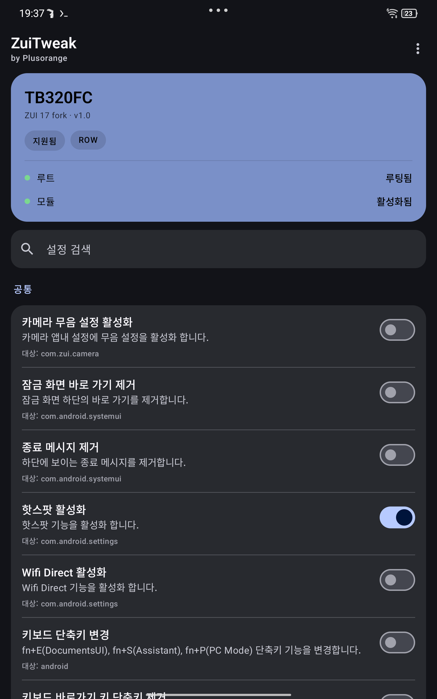
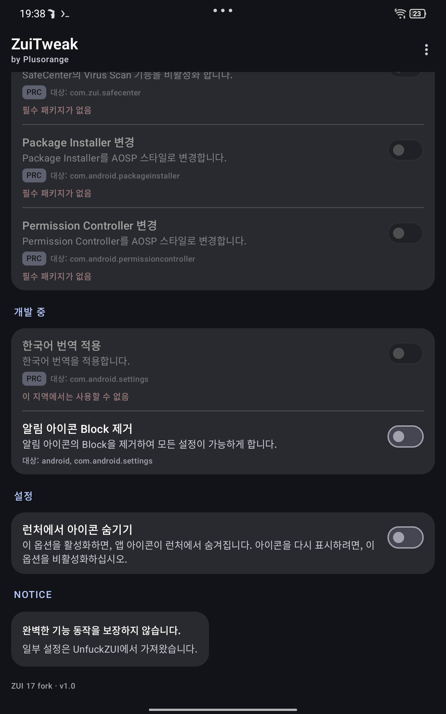

# ZuiTweak — ZUI 17 포크

[English](README.md) · [Русский](README.ru.md) · **한국어**

[](LICENSE)
[](#요구-사항)
[](#호환성)
[](../../releases)
[](https://github.com/Plusorange1/ZuiTweak/actions/workflows/build.yml)

Lenovo Legion Tab의 ZUI에서 숨겨진 기능을 열고 불편한 부분을 고치는 Material 3
Xposed 모듈입니다.

[forumi0721/ZuiTweak](https://github.com/forumi0721/ZuiTweak)의 포크이며 다음이
포함되어 있습니다.

- **ZUI 17 (Android 15) 지원** — ZUI 17에서 옮겨진 클래스로 훅을 다시 연결
  (`com.lenovo.settings.*`, `launcher3.DeviceProfile`, `DolbyAtmosUtils` 등)
- **러시아어 추가** (영어 / 한국어 / 러시아어)
- **Material 3 UI** — 상태 카드, 그룹 카드, 검색, 배지, 언어 선택 창
- **작업 표시줄 토글 재활성화** 및 ZUI 17 대응

<p align="center">
  
  
</p>

---

## 호환성

| 기기 | 모델 | ZUI 15 | ZUI 16 | ZUI 17 (Android 15) |
|---|---|:--:|:--:|:--:|
| Legion Tab Gen 2 / Y700 2023 | `TB320FC` | ✅ 원본 | ✅ 원본 | ✅ **이 포크** |
| Xiaoxin Pad Pro 12.7 | `TB371FC` | ✅ 원본 | ✅ 원본 | ⚠️ 미검증 |

검증 펌웨어: `TB320FC_ROW_OPEN_USER_Q00031.0_V_ZUI_17.0.313_ST_250808` (ROW, Android 15).

다른 모델에서는 모듈이 동작하지 않습니다. 일부 트윅은 **ROW**(글로벌) 또는
**PRC**(중국) 펌웨어 전용이며, 앱에서 사용할 수 없는 항목은 배지와 이유가 표시됩니다.

## 기능

**ZUI 17 ROW** 기준 코드 레벨 지원 상태입니다. 세부 내용은
[docs/COMPATIBILITY.md](docs/COMPATIBILITY.md)를 참고하세요.

### 공통

| 트윅 | 상태 |
|---|:--:|
| 카메라 무음 모드 | ✅ |
| 잠금 화면 바로 가기 제거 | ✅ |
| 종료 메시지 제거 | ✅ |
| 핫스팟 활성화 | ✅ |
| Wi-Fi Direct 활성화 | ✅ |
| 키보드 단축키 변경 | ✅ |
| 키보드 단축키 안내 제거 | ✅ |
| 숨겨진 디스플레이 설정 확장 | ✅ |
| 게임 서비스 아이콘 제거 | ✅ |
| 펜 버튼 자동 활성화 중지 | ✅ |

### ROW (글로벌 펌웨어)

| 트윅 | 상태 |
|---|:--:|
| 배터리 소모 경고 | ✅ |
| Smart Split (One Vision) | ✅ |
| Multiple Space | ❌ ZUI 17에서 클래스가 제거됨 |

### Unfuck ZUI

| 트윅 | 상태 |
|---|:--:|
| 알림 아이콘 변경 | ✅ |
| 내장 스피커 Dolby Atmos 비활성화 | ✅ |
| 앱 강제 종료 비활성화 | ✅ |
| 작업 표시줄 비활성화 | ✅ (이 포크에서 재활성화) |
| 바이러스 검사 비활성화 | ⚠️ PRC 전용 |
| AOSP 패키지 설치 프로그램 | ⚠️ PRC 전용 |
| AOSP 권한 컨트롤러 | ⚠️ PRC 전용 |

### 기기별

| 트윅 | 대상 |
|---|---|
| 펜 서비스 활성화 | `TB371FC` |

## 요구 사항

| 구성 요소 | 최소 |
|---|---|
| 기기 | `TB320FC` 또는 `TB371FC` |
| 펌웨어 | ZUI 15 / 16 / 17 (Android 12+) |
| 루트 | Magisk 27+ (KernelSU/APatch 가능) |
| Zygisk | Magisk 내장, [NeoZygisk](https://github.com/JingMatrix/NeoZygisk) 또는 [Zygisk Next](https://github.com/Dr-TSNG/ZygiskNext) |
| Xposed | [Vector](https://github.com/JingMatrix/Vector/releases) **2.x (권장)** 또는 LSPosed 1.9.2 (Android ≤ 14) |

> Android 15에서는 **Vector**를 사용하세요. 기존 LSPosed는 아카이브되었고
> Android 15를 지원하지 않습니다.

## 설치

1. **루팅** 후 **Zygisk**를 켭니다 (Magisk → 설정 → Zygisk → 재부팅).
   Zygisk 구현이 여러 개라면 **하나만** 남기세요.
2. [Vector](https://github.com/JingMatrix/Vector/releases) 릴리스 zip을 Magisk
   모듈로 설치하고 재부팅합니다.
3. [Releases](../../releases)에서 `ZuiTweak-*.apk`를 설치합니다.
   이전 버전이 있으면 먼저 삭제하세요 (서명 키가 다릅니다).
4. Vector에서 **모듈 → ZuiTweak → 활성화** 후 스코프를 지정합니다.

   ```
   com.android.settings
   com.android.systemui
   com.android.permissioncontroller
   com.android.packageinstaller
   com.android.documentsui
   com.zui.launcher
   com.zui.desktoplauncher
   com.zui.camera
   com.zui.safecenter
   com.zui.version
   com.zui.game.service
   com.lenovo.penservice
   ```

5. 한 번 **재부팅**합니다 (시스템 프로세스에 훅이 주입되어야 합니다).
6. ZuiTweak을 열어 필요한 트윅을 켭니다.

자세한 안내: [docs/INSTALL.md](docs/INSTALL.md).

## 사용법

- **언어** — ⋮ → Language → English / 한국어 / Русский. 첫 실행 시 시스템 언어를
  따르며, 선택은 Xposed 공유 설정에 저장됩니다.
- **검색** — 제목과 설명으로 트윅을 필터링합니다.
- **사용할 수 없는 항목**은 흐리게 표시되고 이유(지역, 패키지 없음, 버전)가
  표시됩니다.
- **재시작 필요** — SystemUI/런처 훅은 SystemUI 재시작 후 적용되며, 재부팅이
  가장 확실합니다.

## 빌드

```bash
git clone https://github.com/Plusorange1/ZuiTweak.git
cd ZuiTweak
./gradlew assembleDebug
# 결과: app/build/outputs/apk/debug/app-debug.apk
```

JDK 17과 Android SDK 34가 필요합니다. Termux 빌드는
[docs/BUILD.md](docs/BUILD.md)를 참고하세요. CI는 푸시마다 debug APK를
빌드합니다.

## 알려진 제한

- **Multiple Space**는 ZUI 17에서 활성화할 수 없습니다. Settings 클래스가
  제거되어 문자열만 남아 있습니다.
- 일부 훅은 Lenovo 내부 클래스에 의존하므로 향후 ZUI 업데이트에서 다시 바뀔 수
  있습니다. 오류는 훅별로 처리되어 시스템이 종료되지는 않습니다.
- 릴리스 APK는 원본과 다른 키로 서명되어 업데이트 시 재설치가 필요합니다.

## 문제 해결

| 증상 | 해결 |
|---|---|
| Vector에 모듈이 보이지 않음 | Zygisk가 꺼져 있거나 두 개가 설치됨 |
| 토글이 아무 효과 없음 | 프로세스가 재시작되지 않음 — SystemUI 재시작 또는 재부팅 |
| 한 항목만 동작하지 않음 | 해당 지역/버전에서 사용할 수 없음 — 배지 확인 |
| 훅 활성화 후 부팅 반복 | Vector에서 모듈 비활성화 후 재부팅 |

## 크레딧

- **[forumi0721](https://github.com/forumi0721)** — 원본 ZuiTweak (ZUI 15/16),
  이 포크는 v3.4.0 기반입니다.
- **StoneCold** — 원본 모듈 개발자.
- **Plusorange** — ZUI 17 포팅, 러시아어 번역, Material 3 UI.
- [Vector](https://github.com/JingMatrix/Vector) / [LSPosed](https://github.com/LSPosed/LSPosed),
  [LSPlant](https://github.com/JingMatrix/LSPlant) — 후킹 프레임워크.

## 라이선스

[Apache License 2.0](LICENSE). 원본의 저작권 및 라이선스 고지를 유지합니다.

> 루팅과 시스템 수정은 사용자 책임입니다. 보증은 없으며, 플래시 전에
> `boot`/`vendor_boot` 백업을 보관하세요.
