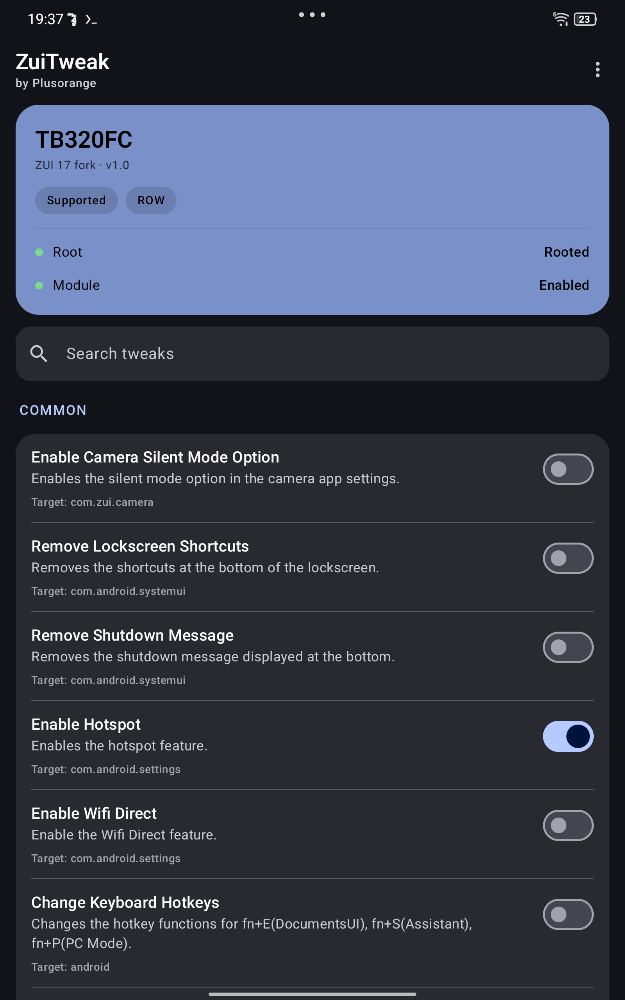
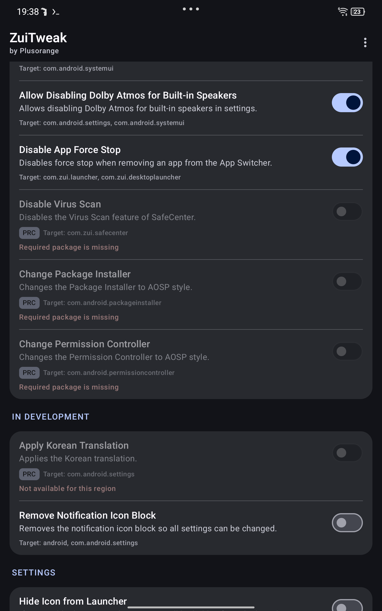

# ZuiTweak — ZUI 17 fork

**English** · [Русский](README.ru.md) · [한국어](README.ko.md)

[](LICENSE)
[](#requirements)
[](#compatibility)
[](../../releases)
[](https://github.com/Plusorange1/ZuiTweak/actions/workflows/build.yml)

A Material 3 Xposed module that unlocks hidden features and fixes ZUI annoyances on
Lenovo Legion Tab devices.

This is a fork of [forumi0721/ZuiTweak](https://github.com/forumi0721/ZuiTweak) with:

- **ZUI 17 (Android 15) support** — hooks re-targeted to the classes ZUI 17 moved
  (`com.lenovo.settings.*`, `launcher3.DeviceProfile`, `DolbyAtmosUtils`, …)
- **Russian localization** (plus the original Korean and English)
- **Material 3 UI** — status card, grouped cards, search, badges, language dialog
- **Taskbar toggle re-enabled** and updated for ZUI 17

<p align="center">
  
  
</p>

---

## Table of contents

- [Compatibility](#compatibility)
- [Features](#features)
- [Requirements](#requirements)
- [Installation](#installation)
- [Usage](#usage)
- [Building](#building)
- [Repository layout](#repository-layout)
- [Known limitations](#known-limitations)
- [Troubleshooting](#troubleshooting)
- [Credits](#credits)
- [License](#license)

## Compatibility

| Device | Model | ZUI 15 | ZUI 16 | ZUI 17 (Android 15) |
|---|---|:--:|:--:|:--:|
| Legion Tab Gen 2 / Y700 2023 | `TB320FC` | ✅ upstream | ✅ upstream | ✅ **this fork** |
| Xiaoxin Pad Pro 12.7 | `TB371FC` | ✅ upstream | ✅ upstream | ⚠️ untested |

Tested firmware: `TB320FC_ROW_OPEN_USER_Q00031.0_V_ZUI_17.0.313_ST_250808` (ROW, Android 15).

The module refuses to run on other models. Region matters: some tweaks exist only for
**ROW** (global) or **PRC** (China) firmware, and the UI marks unavailable options with a
badge and a reason.

## Features

Status is code-level support on **ZUI 17 ROW**; runtime behaviour depends on the exact
firmware build. See [docs/COMPATIBILITY.md](docs/COMPATIBILITY.md) for the per-hook matrix.

### Common

| Tweak | Status |
|---|:--:|
| Enable camera silent-mode option | ✅ |
| Remove lockscreen shortcuts | ✅ |
| Remove shutdown message | ✅ |
| Enable hotspot | ✅ |
| Enable Wi-Fi Direct | ✅ |
| Change keyboard hotkeys | ✅ |
| Disable keyboard shortcut hotkey menu | ✅ |
| Expand hidden display settings | ✅ |
| Remove unused game-service icons | ✅ |
| Disable automatic pen-button activation | ✅ |

### ROW (global firmware)

| Tweak | Status |
|---|:--:|
| Battery power-consumption warning | ✅ |
| Smart Split (One Vision) | ✅ |
| Multiple Space | ❌ not portable — no `MultiSpace*` classes left in ZUI 17 |

### Unfuck ZUI

| Tweak | Status |
|---|:--:|
| Change notification icon | ✅ |
| Allow disabling Dolby Atmos for built-in speakers | ✅ |
| Disable app force-stop in recents | ✅ |
| Disable taskbar display | ✅ (re-enabled in this fork) |
| Disable virus scan | ⚠️ PRC only |
| AOSP package installer | ⚠️ PRC only |
| AOSP permission controller | ⚠️ PRC only |

### Device-specific

| Tweak | Applies to |
|---|---|
| Enable pen service | `TB371FC` |

### Development (debug builds only)

Apply Korean translation, remove notification-icon block.

## Requirements

| Component | Minimum |
|---|---|
| Device | `TB320FC` or `TB371FC` |
| ROM | ZUI 15 / 16 / 17 (Android 12+) |
| Root | Magisk 27+ (KernelSU/APatch also work) |
| Zygisk | Magisk built-in, [NeoZygisk](https://github.com/JingMatrix/NeoZygisk) or [Zygisk Next](https://github.com/Dr-TSNG/ZygiskNext) |
| Xposed | [Vector](https://github.com/JingMatrix/Vector/releases) **2.x (recommended)** or LSPosed 1.9.2 (Android ≤ 14) |

> On Android 15 use **Vector** — classic LSPosed is archived and does not support it.

## Installation

1. **Root the tablet** and enable **Zygisk**
   (Magisk → Settings → Zygisk; reboot).
   If several Zygisk providers are installed, enable **exactly one** — a competing
   implementation is the usual cause of Xposed modules silently not loading.

2. **Install the Xposed framework**
   Download the [Vector](https://github.com/JingMatrix/Vector/releases) release zip and
   install it as a Magisk module, then reboot. Open the manager from the notification.

3. **Install ZuiTweak**
   Grab `ZuiTweak-*.apk` from [Releases](../../releases) and install it.
   Uninstall any older ZuiTweak first — this fork is signed with a different key.

4. **Activate the module**
   In Vector: **Modules → ZuiTweak → enable**, then set its scope:

   ```
   com.android.settings
   com.android.systemui
   com.android.permissioncontroller
   com.android.packageinstaller
   com.android.documentsui
   com.zui.launcher
   com.zui.desktoplauncher
   com.zui.camera
   com.zui.safecenter
   com.zui.version
   com.zui.game.service
   com.lenovo.penservice
   ```

5. **Reboot** once so the hooks are injected into the system processes.

6. **Configure** — open ZuiTweak, flip the toggles you want.
   Some toggles only affect processes that are already running; use the ⋮ menu →
   **Reload** or reboot.

Detailed guide with screenshots: [docs/INSTALL.md](docs/INSTALL.md).

## Usage

- **Language** — ⋮ → Language → English / 한국어 / Русский. The app follows the system
  language on first launch; the choice is stored in the Xposed shared-prefs store.
- **Search** — filter tweaks by title or description.
- **Unavailable options** are dimmed and show the reason (wrong region, missing package,
  unknown version) instead of a debug string.
- **Restart requirement** — SystemUI/launcher hooks apply after a SystemUI restart; a
  reboot is the reliable path.

## Building

Android Studio or the CLI:

```bash
git clone https://github.com/Plusorange1/ZuiTweak.git
cd ZuiTweak
./gradlew assembleDebug
# output: app/build/outputs/apk/debug/app-debug.apk
```

Requires JDK 17 and Android SDK 34. Release builds need `app/release-keystore.jks` and the
`storePassword` / `keyAlias` / `keyPassword` environment variables.

Building in **Termux** works too — see [docs/BUILD.md](docs/BUILD.md) for the `aapt2`
override. CI builds the debug APK on every push (`.github/workflows/build.yml`).

## Repository layout

```
app/src/main/java/kr/stonecold/zuitweak/
├── hooks/            one class per tweak (Xposed hooks)
├── common/           prefs, locale, utilities
├── ui/theme/         Material 3 theme
├── SettingsActivity  main screen
└── HookManager.kt    hook registry
app/src/main/res/
├── values/           English
├── values-ko/        Korean
└── values-ru/        Russian
docs/                 install, compatibility, build, porting notes
```

## Known limitations

- **Multiple Space** cannot be enabled on ZUI 17: the Settings classes were removed, only
  resource strings remain.
- Some hooks depend on Lenovo-internal classes; a future ZUI update can rename them again.
  Failures are caught per hook and logged, they do not crash the system.
- Release APKs are not published with an upstream key — updates require reinstalling.

## Troubleshooting

| Symptom | Fix |
|---|---|
| Module does not appear in Vector | Zygisk disabled, or two Zygisk providers installed |
| Toggles do nothing | process not restarted — reload SystemUI or reboot |
| Everything works except one option | that option is unavailable on your region/version; check the badge |
| Bootloop after enabling a hook | disable the module from Vector (or `su -c 'touch /data/adb/modules/zygisk_vector/disable'`) and reboot |
| "SELinux policy not loaded" in Vector | remove the competing Zygisk implementation and reboot |

## Credits

- **[forumi0721](https://github.com/forumi0721)** — original ZuiTweak (ZUI 15/16), this fork
  is based on v3.4.0.
- **StoneCold** — original module author branding.
- **Plusorange** — ZUI 17 port, Russian localization, Material 3 UI.
- [Vector](https://github.com/JingMatrix/Vector) / [LSPosed](https://github.com/LSPosed/LSPosed)
  and [LSPlant](https://github.com/JingMatrix/LSPlant) — hooking framework.
- [jadx](https://github.com/skylot/jadx) — used to reverse the ZUI 17 classes.

## License

[Apache License 2.0](LICENSE). This is a derivative work; the original copyright and
license notices are preserved.

> Rooting and modifying system software is at your own risk. No warranty is provided;
> keep a boot/vendor_boot backup before flashing anything.
