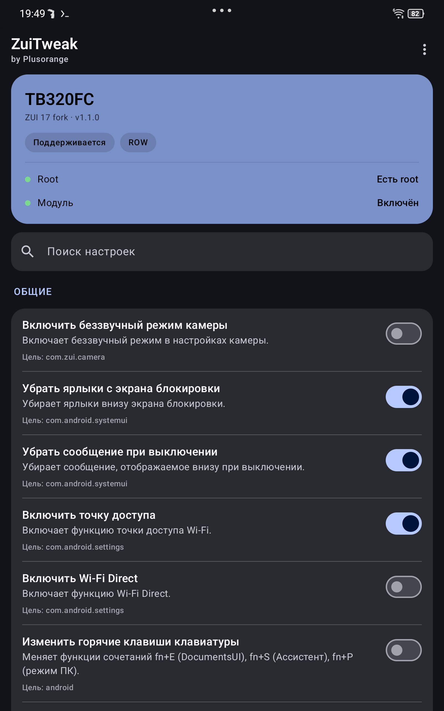
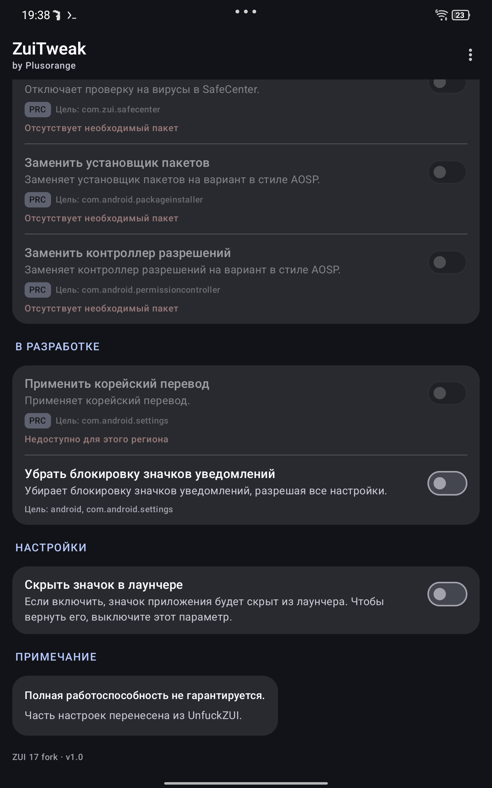

# ZuiTweak — форк для ZUI 17

[English](README.md) · **Русский** · [한국어](README.ko.md)

[](LICENSE)
[](#требования)
[](#совместимость)
[](../../releases)
[](https://github.com/Plusorange1/ZuiTweak/actions/workflows/build.yml)

Xposed-модуль с интерфейсом Material 3, который открывает скрытые функции и исправляет
раздражающие мелочи прошивки ZUI на планшетах Lenovo Legion Tab.

Это форк [forumi0721/ZuiTweak](https://github.com/forumi0721/ZuiTweak), в котором:

- **поддержка ZUI 17 (Android 15)** — хуки переведены на классы, которые ZUI 17 перенёс
  (`com.lenovo.settings.*`, `launcher3.DeviceProfile`, `DolbyAtmosUtils` и т. д.);
- **русская локализация** (плюс исходные корейский и английский);
- **интерфейс Material 3** — карточка состояния, сгруппированные карточки, поиск,
  бейджи и диалог выбора языка;
- **тумблер панели задач снова включён** и обновлён под ZUI 17.

<p align="center">
  
  
</p>

---

## Содержание

- [Совместимость](#совместимость)
- [Возможности](#возможности)
- [Требования](#требования)
- [Установка](#установка)
- [Использование](#использование)
- [Сборка](#сборка)
- [Структура репозитория](#структура-репозитория)
- [Ограничения](#ограничения)
- [Решение проблем](#решение-проблем)
- [Благодарности](#благодарности)
- [Лицензия](#лицензия)

## Совместимость

| Устройство | Модель | ZUI 15 | ZUI 16 | ZUI 17 (Android 15) |
|---|---|:--:|:--:|:--:|
| Legion Tab Gen 2 / Y700 2023 | `TB320FC` | ✅ оригинал | ✅ оригинал | ✅ **этот форк** |
| Xiaoxin Pad Pro 12.7 | `TB371FC` | ✅ оригинал | ✅ оригинал | ⚠️ не проверялось |

Проверено на прошивке: `TB320FC_ROW_OPEN_USER_Q00031.0_V_ZUI_17.0.313_ST_250808` (ROW, Android 15).

На других моделях модуль не запускается. Регион важен: часть твиков существует только для
**ROW** (глобальная прошивка) или **PRC** (китайская), и в интерфейсе недоступные пункты
помечены бейджем и причиной.

## Возможности

Статус — поддержка на уровне кода для **ZUI 17 ROW**; фактическая работа зависит от сборки
прошивки. Подробная таблица: [docs/COMPATIBILITY.md](docs/COMPATIBILITY.md).

### Общие

| Твик | Статус |
|---|:--:|
| Беззвучный режим камеры | ✅ |
| Убрать ярлыки с экрана блокировки | ✅ |
| Убрать сообщение при выключении | ✅ |
| Включить точку доступа | ✅ |
| Включить Wi-Fi Direct | ✅ |
| Изменить горячие клавиши клавиатуры | ✅ |
| Отключить меню горячих клавиш | ✅ |
| Расширить скрытые настройки экрана | ✅ |
| Убрать лишние значки игрового сервиса | ✅ |
| Отключить автозапуск кнопки пера | ✅ |

### ROW (глобальная прошивка)

| Твик | Статус |
|---|:--:|
| Предупреждение о расходе батареи | ✅ |
| Smart Split (One Vision) | ✅ |
| Multiple Space | ❌ не переносится — в ZUI 17 не осталось классов `MultiSpace*` |

### Unfuck ZUI

| Твик | Статус |
|---|:--:|
| Изменить значок уведомлений | ✅ |
| Разрешить отключение Dolby Atmos для динамиков | ✅ |
| Отключить принудительную остановку в недавних | ✅ |
| Отключить панель задач | ✅ (включено в этом форке) |
| Отключить проверку на вирусы | ⚠️ только PRC |
| Установщик пакетов в стиле AOSP | ⚠️ только PRC |
| Контроллер разрешений в стиле AOSP | ⚠️ только PRC |

### Для устройства

| Твик | Для |
|---|---|
| Включить службу пера | `TB371FC` |

### В разработке (только debug-сборки)

Применить корейский перевод, убрать блокировку значков уведомлений.

## Требования

| Компонент | Минимум |
|---|---|
| Устройство | `TB320FC` или `TB371FC` |
| Прошивка | ZUI 15 / 16 / 17 (Android 12+) |
| Root | Magisk 27+ (KernelSU/APatch тоже подходят) |
| Zygisk | встроенный в Magisk, [NeoZygisk](https://github.com/JingMatrix/NeoZygisk) или [Zygisk Next](https://github.com/Dr-TSNG/ZygiskNext) |
| Xposed | [Vector](https://github.com/JingMatrix/Vector/releases) **2.x (рекомендуется)** или LSPosed 1.9.2 (Android ≤ 14) |

> На Android 15 используйте **Vector**: классический LSPosed архивирован и Android 15 не
> поддерживает.

## Установка

1. **Получите root** и включите **Zygisk**
   (Magisk → Настройки → Zygisk; перезагрузка).
   Если установлено несколько реализаций Zygisk, оставьте **ровно одну** — конкурирующие
   реализации чаще всего и приводят к тому, что модуль «молчит».

2. **Установите Xposed-фреймворк**
   Скачайте zip [Vector](https://github.com/JingMatrix/Vector/releases), установите как
   модуль Magisk и перезагрузитесь. Менеджер открывается из уведомления.

3. **Установите ZuiTweak**
   Возьмите `ZuiTweak-*.apk` из [Releases](../../releases). Если стояла старая версия —
   сначала удалите её: у форка другая подпись.

4. **Активируйте модуль**
   В Vector: **Модули → ZuiTweak → включить**, затем задайте область внедрения:

   ```
   com.android.settings
   com.android.systemui
   com.android.permissioncontroller
   com.android.packageinstaller
   com.android.documentsui
   com.zui.launcher
   com.zui.desktoplauncher
   com.zui.camera
   com.zui.safecenter
   com.zui.version
   com.zui.game.service
   com.lenovo.penservice
   ```

5. **Перезагрузитесь** один раз, чтобы хуки внедрились в системные процессы.

6. **Настройте** — откройте ZuiTweak и включите нужные тумблеры.
   Часть из них действует только на уже запущенные процессы: меню ⋮ → **Перезагрузить**
   или перезагрузка планшета.

Подробная инструкция: [docs/INSTALL.md](docs/INSTALL.md).

## Использование

- **Язык** — ⋮ → Язык → English / 한국어 / Русский. При первом запуске приложение берёт
  язык системы; выбор сохраняется в хранилище Xposed-настроек.
- **Поиск** — фильтр по названию и описанию.
- **Недоступные пункты** затемнены и показывают причину (регион, отсутствующий пакет,
  версия), а не отладочную строку.
- **Перезапуск** — хуки SystemUI и лаунчера применяются после перезапуска SystemUI;
  надёжнее всего перезагрузка.

## Сборка

Android Studio или командная строка:

```bash
git clone <url-вашего-форка>
cd ZuiTweak
./gradlew assembleDebug
# результат: app/build/outputs/apk/debug/app-debug.apk
```

Нужны JDK 17 и Android SDK 34. Для release-сборки требуется `app/release-keystore.jks` и
переменные окружения `storePassword` / `keyAlias` / `keyPassword`.

Сборка в **Termux** тоже возможна — см. [docs/BUILD.md](docs/BUILD.md) (нужен override для
`aapt2`). CI собирает debug APK при каждом пуше (`.github/workflows/build.yml`).

## Структура репозитория

```
app/src/main/java/kr/stonecold/zuitweak/
├── hooks/            по классу на твик (Xposed-хуки)
├── common/           настройки, локаль, утилиты
├── ui/theme/         тема Material 3
├── SettingsActivity  главный экран
└── HookManager.kt    реестр хуков
app/src/main/res/
├── values/           английский
├── values-ko/        корейский
└── values-ru/        русский
docs/                 установка, совместимость, сборка, заметки о порте
```

## Ограничения

- **Multiple Space** на ZUI 17 включить нельзя: классы Settings удалены, остались только
  строковые ресурсы.
- Часть хуков завязана на внутренние классы Lenovo; будущее обновление ZUI может их снова
  переименовать. Ошибки перехватываются отдельно для каждого хука и не роняют систему.
- Release-сборки подписаны не тем же ключом, что у оригинала, — обновление требует
  переустановки.

## Решение проблем

| Симптом | Что делать |
|---|---|
| Модуль не виден в Vector | Zygisk выключен или установлено две реализации Zygisk |
| Тумблеры ничего не делают | процесс не перезапущен — перезапустите SystemUI или планшет |
| Всё работает, кроме одного пункта | опция недоступна для вашего региона/версии — смотрите бейдж |
| Загрузочный цикл после включения хука | отключите модуль в Vector (или `su -c 'touch /data/adb/modules/zygisk_vector/disable'`) и перезагрузитесь |
| «SELinux policy not loaded» в Vector | уберите конкурирующую реализацию Zygisk и перезагрузитесь |

## Благодарности

- **[forumi0721](https://github.com/forumi0721)** — оригинальный ZuiTweak (ZUI 15/16), форк
  основан на v3.4.0.
- **StoneCold** — автор оригинального модуля.
- **Plusorange** — порт на ZUI 17, русская локализация, интерфейс Material 3.
- [Vector](https://github.com/JingMatrix/Vector) / [LSPosed](https://github.com/LSPosed/LSPosed)
  и [LSPlant](https://github.com/JingMatrix/LSPlant) — фреймворк хуков.
- [jadx](https://github.com/skylot/jadx) — декомпиляция классов ZUI 17.

## Лицензия

[Apache License 2.0](LICENSE). Это производная работа; уведомления об авторских правах и
лицензии оригинала сохранены.

> Root и модификация системы — на ваш риск. Гарантий нет; перед прошивкой чего-либо
> сохраните резервную копию `boot`/`vendor_boot`.
